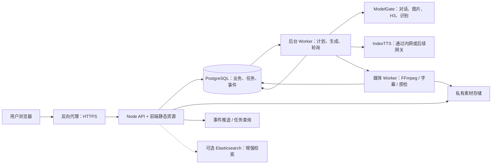

# 兴图智创：AI 视频、智能体与公网部署设计

设计基准：2026-10-28。本文是方案，不代表其中的新功能已经实现或模型效果已经验收。上线初期按小规模使用设计；并发生成能力以实际网关和 GPU 测试为准。

## 1. 建议先定的方向

1. 保留当前 React/Node 技术栈，升级为“模块化业务服务 + 独立后台 Worker + PostgreSQL 持久队列”。初期可以部署在一台 Linux 服务器，不需要把所有模块拆成微服务。
2. 智能体负责理解意图、写方案、组织分镜和调用受控工具；视频生成、状态恢复、计费、媒体合成由确定性的任务流程负责。模型不直接决定无限重试，也不直接执行系统命令。
3. 长视频由智能体在后台自动分镜、调度短视频和合成。用户默认只输入需求、素材和目标时长，可选上传首尾帧，然后点击生成；不需要操作分镜、画布或时间线。
4. 左侧只新增一个“配音与口型”入口，使用同一个页面完成配音、换音和可选口型同步；音色管理在页面内用小弹窗完成。
5. 优先借鉴并适配 XT 工作台已有的创作技能、分镜与媒体工作流；暂不将整套 DeerFlow 或 OpenCode 作为每个用户请求的运行时。
6. 对产品外观、字幕准确、配音同步等效果建立真实验收集。不能仅凭任务状态成功或提示词里写了“高清”就认定成片达标。

## 2. 现状：已确认和待验证

### 2.1 现有实现

| 功能 | 当前代码行为 | 设计影响 |
| --- | --- | --- |
| 智能体聊天 | 读取会话历史，按技能拼接提示词，调用 ModelGate 对话；失败可回退模板。 | 属于单模型聊天，不是完整的多步骤工具调度。 |
| 爆款复刻 | 接收链接，但视频生成分支主要使用提示词，没有读取链接对应视频。 | 应先做真实素材导入与拆解，结果要有来源依据。 |
| AI 梦工厂 | 以产品图作为首帧调用 H3 图生视频；当前生成分支没有正确使用界面提交的时长。 | 保留图生视频链路，补齐时长、画幅、参数校验及真实产物验证。 |
| AI 商拍 | 校验上传图片，但当前生图调用只传文本，没有把商品图交给模型。 | 不能承诺商品图保真；需要真实图像编辑能力或保留商品原图的合成流程。 |
| AI 素材场 | 表单可提交多种参考素材；当前实现仅把第一张参考图用于图生视频，其他参考主要变成数量描述。 | 根据网关实际能力调整输入控件，不把未发送的素材称为已参考。 |
| 视频解析 | 当前卡片走的分析分支把链接作为文本交给语言模型；另有场景分析接口返回固定示例。 | 必须接入可获取的真实视频，基于实际帧、语音与字幕分析。 |
| 百变数字人 | 使用 H3 文生或首帧图生视频；之后可叠加 Edge TTS 配音与 ASS 字幕。 | 它不是音频驱动的专业数字人，当前没有真正口型同步。 |

主要代码：[AI 任务执行](../server/src/services/aiEngine.js)、[模型适配](../server/src/services/aiProviders.js)、[智能体对话](../server/src/routes/agent.js)、[字幕处理](../server/src/services/subtitleBurn.js)、[当前 TTS](../server/src/services/tts.js)。

### 2.2 必须优先修正的参数问题

- 现有 ModelGate 手册规定视频 size 为“高、宽”。素材场的 9:16 和 16:9 代码参数与此方向相反；数字人的竖屏参数也有同类问题。应以网关当前契约和实际 ffprobe 输出联合验证，统一用结构化 width、height 表达，适配器再转换成网关顺序。
- 现有代码把素材场的 8 秒请求转换为 248 帧，再经裁剪和取整得到 243 帧；手册列出的有效帧数截至 226。应以网关当前版本的能力表为准，从合法帧集合选择。例如在手册约束与 24 fps 成立时，8 秒可选 192 帧；4 秒需先生成可用的最短片段再精确裁剪。最终以实际输出核验。
- 当前“720P/1080P”等界面选项并不都映射到真实生成尺寸。方案必须同时记录并展示“请求尺寸、实际生成尺寸、最终导出尺寸”；升尺度导出不等于原生生成了更多细节。

### 2.3 网关和语音服务

- 本机当前配置的 ModelGate 模型列表经只读查询可见 8 个模型，包括 MiniMax-H3、对话、生图、ASR、OCR、分割、向量和重排，当前列表没有 TTS。
- 用户提供的 [IndexTTS-2.5 服务文档](C:/Users/张世成/Desktop/IndexTTS-vLLM-API.md) 描述了独立的 vLLM-Omni 服务。对 192.168.100.20:8092 的只读健康检查与模型列表查询返回成功，模型列表包含 IndexTTS-2.5；本次没有调用真实语音合成。
- 文档说明该服务目前无有效鉴权、音色名称全局共享且同名可覆盖；其后接入 ModelGate 时必须处理鉴权、租户隔离和音色命名。最终网关路径、权限和配额仍须按接入后的真实契约核对。
- H3 手册提供文生、首帧、尾帧、首尾帧四种模式；手册记录 2026-10-26 四种模式均完成过真实生成和 MP4 下载，每条约 5.175 秒。这是当时的验证，不能保证之后每次服务都成功。当前应用实际主要使用文生和首帧模式。
- 2026-10-28 对当前账号已有成功任务做只读媒体探测，实际样本分别为 512×896 / 5.175 秒、960×544 / 5.175 秒、1280×736 / 7.3 秒，均为 24 fps 且含音轨；这些是样本而不是对所有尺寸和时长的性能保证。账号内历史记录也有失败，需按实际错误排查。
- 手册中的尺寸校验范围为高和宽各 256–2048 像素、32 的倍数；这是接口接收范围，不能据此承诺任意 2K 分辨率、显存配置或成片质量都可用。帧数允许 124、141、158、175、192、209、226，24 fps；约 5.17–9.42 秒，具体以真实产物为准。4 秒可在最短生成片段后裁剪。

### 2.4 全站真实化要求

所有用户可见的生产功能和业务数据必须可追溯到实际操作、真实模型产物或已授权的外部数据源。已有数据库中的演示内容不能一刀切删除：先备份并核实来源，保护用户新建的脚本、素材和作品。

真实模型、图像编辑、支付或广告平台等能力暂时缺失时，应显示未接通及具体原因，不得返回示例结果或虚构成功。逐项核查和改造计划见 [功能真实性审计与改造清单](06_功能真实性审计与改造清单.md)。

## 3. 推荐部署架构



**小规模部署**：一台 Linux 主机运行反向代理、API、一个或多个 Worker、PostgreSQL 和媒体处理进程；模型仍通过现有网关调用。初期素材可以落在持久化本地目录，但必须经过存储接口和鉴权；未来多台服务器共享时替换为 S3 兼容对象存储。Elasticsearch 暂作为可选服务，不阻塞视频生成。

**边界**：前端不持有模型密钥，也不直接访问内网 IndexTTS；网关和 TTS 仅允许应用服务器访问。API 负责会话和权限，不同步等待几分钟的 H3 或 FFmpeg 导出。H3 推理并发由网关与 GPU 容量决定，不能通过增加网页或 Node 进程凭空提高。

### 3.1 轻量技术选型

| 职责 | 首选 | 原因与扩展 |
| --- | --- | --- |
| 前端 | 延用 React、TypeScript、Ant Design 和现有视觉风格 | 保留当前页面和操作习惯，逐步替换能力。 |
| API 与编排 | 延用 Node.js，按业务模块划分；Worker 以独立进程启动 | 先保持一个仓库，避免跨服务通信和运维复杂度。 |
| 数据库与队列 | PostgreSQL + pg-boss 或等效的 PostgreSQL 持久队列 | 用户、工程、任务和队列共用一套基础设施；后续再根据负载引入 Redis 等组件。 |
| 素材 | 私有持久目录，经资产服务访问；多节点时接对象存储 | 不把上传目录直接开放成无需鉴权的静态目录。 |
| 媒体 | FFmpeg/FFprobe + 可配置中文字体 | 处理拼接、音轨、字幕、缩放和技术检查；Linux 镜像必须实际打包并验证依赖。 |
| 检索 | PostgreSQL 基础检索；需要高级语义检索时接 Elasticsearch | 避免把可选检索组件变为生成链路的单点。 |

pg-boss 使用 PostgreSQL 的任务领取机制，适合在已有 PostgreSQL 的系统里减少基础设施；仍必须自行处理外部模型调用的幂等和恢复。[项目文档](https://github.com/timgit/pg-boss)

## 4. 智能体与执行引擎

### 4.1 两层职责

**创作智能体**：把用户输入、商品资料和适用技能整理为结构化的内部创作方案；在允许范围内调用“读取素材、生成分镜、生成画面、预览、导出”等工具。内部方案记录素材来源、缺失项、每镜时长、参考素材角色和预估资源，不要求用户手动编辑。

**工作流执行器**：按服务端定义的步骤图执行，负责输入校验、依赖关系、队列、并发限制、模型提交、结果校验和保存。不是让语言模型持续占着进程等待生成，也不让模型自由决定计费或访问任意文件。

简化数据流：

用户填写需求并点击生成 → 智能体在后台自动完成方案与分镜 → 服务端校验参数与预算 → 后台分步执行 → 自动合成和质检 → 用户预览并下载。只有缺少会阻止制作的必要素材或超过预算时才请求用户处理；制作过程详情按需展开，不强制用户确认每个镜头。

保留技能、工具和模型适配器三种独立概念：技能是创作方法；工具是有明确输入输出和权限的可执行能力；模型适配器把工具调用转换为特定网关协议。技能提示词不能自行扩大工具权限。

### 4.2 与两个现有项目的关系

| 参考项目 | 观察 | 建议 |
| --- | --- | --- |
| SeekBuddy / DeerFlow | 具有通用 Agent、工具、技能、沙箱、子智能体、记忆等能力；本机版本还包含网关和连接器。它更偏开放式长任务。 | 参考技能按需加载、工具权限、长任务状态与产物交付；不要默认把完整桌面产品和沙箱集群装进每个电商视频请求。 |
| XT 工作台 / OpenCode | 本机项目已有自研创作 Agent 循环、创作技能、媒体编辑与工程；代码任务才由 OpenCode 执行器负责。 | 优先评估复用其自研分镜、技能编排、时间线、音轨与导出代码。不要把桌面端、Windows 专用可执行文件或 OpenCode 编码运行时原样搬到 Linux 公网服务。 |

“重不重”需要测量进程内存、启动时间、同时运行数和模型等待时的资源占用，不能根据项目目录体积判断。若以后需要复杂研究或独立策划，可将 DeerFlow 作为可选外围服务，以受限 API 接入；视频生成可靠性仍由本项目的任务执行器保证。[DeerFlow 架构](https://github.com/bytedance/deer-flow/blob/main/docs/ARCHITECTURE.md)

### 4.3 技能迁移

XT 工作台已有 25 项创作技能，以及商品短片、完整视频制作、工程验收等内部能力。第一批建议适配：

1. 商品短片与极简产品广告：商品事实、实物图优先、卖点、场景及 CTA。
2. H3 镜头提示词：镜头动作、首尾状态、运镜、画面与声音分开表达。
3. 参考片拆解：先记录真实采样帧和时间，区分事实、推测与缺失。
4. 品牌宣传、口播创作和工程交付：统一角色、字幕、声音和导出检查。

MiniMax 官方 H3 仓库提供可移植的提示词技能；其他八个风格技能依赖其画布和专属工具，不能直接复制就运行。应参考公开流程并适配为本系统自己的工具契约；优先使用 XT 中已有的独立编写版本。导入前记录来源、版本、依赖及适用许可，不复制安装包里的私有凭据或未经核实的资源。[MiniMax H3 官方说明](https://github.com/MiniMax-AI/MiniMax-H3)

技能包建议包含：名称和用途、适用输入、版本、提示词、结构化输出模式、允许工具、引用资料和验收规则。每次运行记录实际使用的技能版本；新增技能不能绕过后端的工具白名单、用户权限和预算。

## 5. 持久任务、并发与计费

### 5.1 状态

面向用户的阶段：填写需求 → 排队 → 正在策划 → 正在生成 → 正在合成 → 完成；另有部分完成、失败、取消、待核对状态。更细的内部阶段只在用户主动查看详情时展示。

每个工程有一个总任务，每个镜头、语音、口型、导出是独立步骤，记录依赖、输入版本、输出资产、请求参数、状态、错误、尝试次数及上游任务 ID。结果已完成的镜头可以单独重做，不影响其他镜头。

### 5.2 防重复和恢复

- 任务创建、点数预留和队列投递需要同一事务或可靠 outbox；重复点击和消息重复投递使用幂等键去重。
- 每次镜头的同一次提交采用稳定幂等键；用户明确重新生成时创建新尝试和新键。提交后尽快持久化网关任务 ID、请求摘要和状态。
- 网络超时不等于上游未受理。先按幂等键、任务 ID 或网关查询能力核对，再决定是否重试；无法确认时标记“待核对”，不能盲目重复扣点或重复提交。
- Worker 可重启；重启后恢复待执行步骤、继续查询已提交的上游任务并重新领取租约。上游可能仍在运行时，不因为本地租约过期就直接释放 GPU 并发名额。
- 取消分为本地停止后续步骤和向上游请求取消；只有网关确认取消才显示上游已停止。已经产生的计算与费用按明确规则结算。
- 生产模式禁用静默模拟成功；模拟素材只允许在显式演示模式使用，并加清晰标识。失败不自动用样片冒充用户作品。

### 5.3 限流和容量

分别限制：每用户/团队的待处理任务、H3 正在上游运行的任务、图像任务、TTS、CPU 导出和语言模型请求。限制是可配置值，不是把网页并发等同于 GPU 并发。小规模初始可从 H3 上游并发 1、导出并发 1 进行压测，再按网关实测调整；其余用户任务正常排队。

队列应提供公平性，避免一个长项目占满全部名额；同时限制单项目的镜头并发。H3 处理平均需要 T 秒、可稳定同时运行 C 个时，理论处理上限约为每小时 3600×C/T 个镜头，实际还要扣除排队、失败、上传和合成开销。

XT 工作台的历史记录曾在其环境中测得一次 1376×768、约 5.175 秒 H3 片段耗时约 101 秒；这是单次历史测量，不代表当前网关吞吐。仅作估算：若 12 镜头依次生成，各花 101 秒，单模型等待约 20 分钟，尚不含重试和剪辑；独立镜头是否能并行取决于实际容量。

### 5.4 费用与可观察性

- 提交时显示预估点数、预计镜头数和可选重试预算；先预留再根据实际完成、取消和失败规则结算，采用不可重复的账本记录。
- 记录请求 ID、工程/镜头 ID、模型版本、真实尺寸、等待时间、上游任务状态和失败原因；不在日志中写密钥和原始隐私素材。
- 监控待处理数量、运行时间、失败率、重复提交、待核对任务、磁盘、数据库、TTS/H3 状态和每用户使用量。页面展示真实阶段，不用定时器虚构百分比。

## 6. 六个现有入口：产品与实现方案

| 入口 | 用户操作 | 后端实现与效果提升 | 主要验收点 |
| --- | --- | --- | --- |
| 爆款复刻 | 上传有权使用的视频或输入可解析链接，再填写自己的商品并点击生成；拆解结果按需查看。 | 导入可访问媒体 → ffprobe → 场景切分/取帧 → ASR/OCR → 可用视觉模型分析 → 生成带时间依据的结构报告 → 转换成新商品分镜。不能读取时明确失败，不编造内容。 | 每个观察能追溯源片时间；商品和文案可修改；不会将示例视频当结果。 |
| AI 梦工厂 | 上传商品图，填写要求和目标时长，画幅等使用默认值或按需调整，再点击生成。 | 原图预处理后真正送入首帧图生视频；长于单次限制时拆镜。输出前核对尺寸、时长和素材是否真实；文字与品牌用后期图层。 | 上传图确实进入请求；实际画幅/时长与所选一致；商品主体偏差可在预览中发现并重做。 |
| AI 商拍 | 上传商品图，选择白底/场景、保持商品主体、张数和尺寸；对比原图与结果。 | 有图像编辑/抠图能力时走带原图和掩码的受控编辑；若当前网关只有文生图，则使用经过验证的商品原图合成方案，或明确暂不支持保真商拍。 | 输出可核验来自原商品，品牌/标签不靠模型瞎画；无能力时不能报“保真成功”。 |
| AI 素材场 | 输入文字，可选上传首帧和尾帧；画幅、时长使用简单选项，界面只开放当前模型真实支持的输入。 | 将首尾帧确实传入；多图/视频/音频参考仅在相应模型和接口验证可用后再评估。明确每项实际生效状态。 | 参考素材、尺寸与时长都体现在实际请求；不支持的选项无法误提交。 |
| 视频解析 | 上传视频或提交可访问链接；选择拆解区间，查看截图、转录和结果时间轴。 | 媒体探测、镜头边界、抽帧、音频提取、ASR、OCR；接入支持真实图片输入的视觉模型后分析画面。没有视觉模型时只展示实际可得信息。 | 截图与时间戳可回看；稀疏采样标明范围；不能凭链接文本编造口播、BGM 或画面。 |
| 百变数字人 | 选经授权的人物/首帧、文本、音色、口型模式和字幕；先试听，再出小样。 | 推荐先合成语音，再准备人物画面，再使用独立口型模型，最后按音频时间轴生成字幕和合成。保留 H3 仅作人物镜头或氛围视频方案。 | 文本说完整、字幕可校对；口型需模型实际执行并经人工抽检；失败给出原因与可用替代。 |

公共要求：默认界面只显示必要输入、生成按钮、真实任务阶段、费用和结果；模型与参数等技术信息按需展开。品牌、价格、功效等事实来自用户确认的资料，不由模型编造。各入口不得输出虚构结果冒充真实产物。

## 7. 新增“长视频制作”

### 7.1 用户界面与点击流程

左侧新增“长视频制作”，与现有六个入口平级。第一版不增加画布、镜头工作台和可视化时间线。

1. **填写需求**：输入文案/创意、目标时长，上传商品或人物素材；可选上传开头首帧和结尾尾帧。画幅和声音提供简单默认值。
2. **一键生成**：点击“开始生成”；页面只展示真实阶段，如“正在策划、正在生成画面、正在合成”。分镜、素材调度、镜头衔接和失败重试在后台完成。
3. **查看成片**：生成后直接播放、下载；可选择整体重新生成。内部保留分段结果以便恢复和将来做局部重试，但第一版不要求用户操作分镜或音视频轨道。

如果缺少必须的素材、授权或余额，系统说明缺什么；无需让用户理解模型、帧数、镜头依赖或 FFmpeg。首尾帧为可选输入：全片首帧用于开头，全片尾帧用于最后一段；中间镜头由智能体自行规划。

### 7.2 推荐制作流水线

1. **建立事实和视觉基准**：商品外观、人物、服装、品牌色、场景、必须出现和禁止出现的内容。商品以用户提供的真实图/视频为准；未经验证的生图编辑不能保证其标志和文字一致。
2. **分镜**：把目标时长拆成可生成的镜头，记录每镜目标画面、动作开始/结束、运镜、旁白、参考资产、目标时长和允许的衔接方式。先校验总时长与叙事。
3. **选择依赖关系**：连续动作的镜头可以依次生成；从实际结果选清晰、稳定的一帧作为下一镜首帧，必要时指定目标尾帧。不同场景、特写、旁白 B-roll 优先独立生成并在网关允许范围内并行。
4. **防止漂移**：每镜都保留同一商品/人物基准与镜头状态，而不是只把上一镜最后一帧无限传递。失败镜头只重做该镜和确实依赖它的后续镜头。
5. **声音先行**：口播段优先生成/导入音频并量取时长，再确定镜头和口型任务；BGM、音效、配音分轨。无音频/无配乐是明确选项。
6. **后期**：剪辑、统一画幅与帧率、音频混音、字幕、封面和片尾文字。转场会重叠时间，时间线总时长必须按实际裁剪与转场重新计算。
7. **检查**：ffprobe 校验视频/音轨、分辨率、时长和可播放性；字幕与音轨要有可追溯时间；产品细节、人物一致性和口型由人工预览或有证据的专项检测审核。

**60 秒示例**：12 个约 5.175 秒的实际镜头，加 11 个约 0.2 秒交叠转场，得到约 59.9 秒；这是时间线计算示例，不代表每镜都必须用同一时长或每次 H3 输出恰好相同。超出目标时长的镜头按真实帧数裁剪。

**首尾帧不是万能连续性方案**：运动模糊、遮挡、光照变化或产品变形会被传递并累积。后台应自动筛选可用帧、保留主参考、局部重试和采用合适的镜头切换；不能把多格分镜拼图当作实际首帧，也不能承诺绝对一致。

### 7.3 更长单镜的研究方向

[TaoMate-H3](https://github.com/TaoLiveAIGC/TaoMate-H3) 提供基于 H3 的流式长视频方案和首尾帧方向，官方示例涉及多 GPU，验证配置使用 8 张 H20；它不是当前网关已具备的能力。作为后期研发选项，先核对硬件、许可、接口、画质和总成本，初版仍以可控的多镜头方案交付。

## 8. 数字人、配音、换音与口型

### 8.1 左侧栏目：“配音与口型”

只做一个页面，而不是新增三个独立页面：

1. 上传视频，填写要说的话或上传已有配音。
2. 选择已有音色；需要新音色时在本页弹窗上传经授权的声音样本并试听。
3. 选择“添加旁白”或“替换原声音轨”；若视频有人物说话，可按需勾选“同步人物口型”。
4. 点击生成，系统自动合成、按需调用口型模型并返回可播放结果。缺少口型模型或素材不适合时，明确提示并允许仅做配音。

数字人和长视频入口复用同一能力；“音色管理”只是本页的弹窗，不增加独立导航页面。高级的原声保留、音量与分离选项折叠，默认不干扰普通用户。

### 8.2 区分三种能力

1. **声音叠加或整轨替换**：大多数可解码视频都能做，但可否保留原音乐和环境声取决于是否有独立音轨。
2. **将原有人声换为另一音色**：先识别文本并使用目标音色重新合成，再校正时长；也可在未来接入真正的声音转换模型来尽量保留原节奏。IndexTTS 的文本转语音不等于现有音频直接变声。
3. **声音与嘴型同步**：需要额外的唇形驱动模型。多人物、遮挡、侧脸、频繁切镜或画面中没有可见嘴部时，质量和适用性受限，不能承诺任意视频都能自然对口型。

对于只有一条混合音轨的素材，自动人声分离可能损伤音乐或残留人声，应让用户试听并允许选择静音原轨、低音量叠加、上传原始分轨或人工修改。生成新视频时提前保留画面、配音、音乐和效果音分轨，可以获得更稳定的后期效果。

### 8.3 IndexTTS-2.5 适配设计

以用户文档为当前契约，后续网关开放时再次核对：

- 音色创建：服务端验证授权和文件，再调用音色上传接口；文档允许 1–30 秒、最大 10 MB，建议界面提示 3–10 秒清晰单人声。引用文稿可选。
- 语音合成：调用 /v1/audio/speech，传 input 和已授权 voice 或参考音频；按文档处理二进制音频响应，而不是当成 JSON。可用 speed 0.5–2.0、语言和情感参数，长文本按自然句拆段。
- 批量接口可用于同音色多句，但文档说明其不支持 extra_params；需要情感或语言参数时逐句合成，不能假设批量参数生效。
- IndexTTS 默认输出 22.05 kHz 单声道 WAV；项目混音统一到目标采样率，例如 48 kHz，但重采样不会提升原音质。
- 文档中的 default 音色只是占位符，不能当成可直接使用的预置音色；界面只能展示已验证可用且当前用户有权使用的音色。
- 音色底层名称使用租户/工作区隔离的随机 ID，展示名单独存储，避免全局同名覆盖。保存授权记录、声音引用和删除策略，不让用户访问其他团队音色。
- 文档中每阶段 max_num_seqs 为 4，不等于已经验证了 4 路端到端并发。如果 TTS 与其他模型共用 GPU，还要统一按实际显存、正在运行的模型和网关容量做资源限制，不能分别把各自理论上限加起来。
- 当前服务文档说明没有有效鉴权，且 ref_audio 支持 URL 和本地文件路径。必须保持内网隔离，由应用/网关鉴权；公网请求不能向 TTS 透传任意 URL 或 file 路径，避免访问内网和服务器文件。
- 当前网关尚未列出 TTS：先做服务端适配器和隔离测试；网关接入后根据真实模型目录、鉴权、请求体、音频响应和错误协议切换，不能凭 OpenAI 兼容外观假定网关已透传所有功能。
- IndexTTS-2.5 权重采用 [bilibili Model Use License Agreement](https://huggingface.co/IndexTeam/IndexTTS-2.5/blob/main/LICENSE)，不是默认的 MIT/Apache 授权；公开商用前应按实际部署和分发方式核对条款，官方项目也提供商务合作联系渠道。

### 8.4 数字人生成顺序

用户提交文案、授权人物素材和音色后，系统自动完成 IndexTTS 分段合成 → 根据实际音频确定段落/镜头长度 → 准备人物视频 → 按需调用口型模型 → 对齐字幕与音轨 → 合成和检查。用户可以试听音色，但不强制逐段操作。

H3 可提供人物画面或环境镜头，但当前接入不是输入指定音频的口型驱动。候选方案可评估 [MuseTalk](https://github.com/TMElyralab/MuseTalk)：其官方仓库说明模型可商业使用，但仍需核对依赖模型许可并实测人脸、嘴型和画质；其已知限制包括面部细节损失和抖动。不要把只适合非商业使用的 Wav2Lip 开源权重直接用于商业产品。[Wav2Lip 项目许可说明](https://github.com/Rudrabha/Wav2Lip)

## 9. 字幕：新增与替换分开

当前实现会将文案按字数比例铺到视频长度，再用 FFmpeg/ASS 烧录，且字体目录写死 Windows 路径；它不代表已精确对齐语音。语音比视频长时目前会冻结末帧补齐，容易造成长时间静止。

建议：

1. **新增字幕**：后台保留字幕时间和 SRT/VTT，默认自动生成；用户需要时可修改字幕文字，无须操作多轨界面。优先使用 TTS 提供的真实时间信息，其次使用带时间戳的 ASR 或强制对齐模型，并允许校对；只有纯文本时不得声称逐字精确对齐。当前 ASR 适配器把结果合并为文本，需改为保留实际返回的时间字段并核对服务能力。
2. **已有可编辑字幕轨**：读取、修改和重新输出；可选择软字幕或烧录。
3. **原视频硬字幕**：像素已经合在画面里，不能像文本一样直接替换。给用户“保留、遮盖后加新字幕、尝试视频修复去字”选项；最后一种需要额外模型与质检，不保证所有背景都能修好。
4. **生成阶段**：优先要求模型不要生成画中文字，把商品名称、价格、字幕和 CTA 放在独立图层；再用可控字体、描边、位置和安全区排版。
5. **Linux 适配**：容器内安装和配置可商用中文字体，FFmpeg 使用实际挂载路径；校验中文、emoji 和 ASS 渲染，不能依赖 Windows 字体目录。

## 10. 数据模型和接口草案

以下是建议新增的契约，不是当前已存在的接口。

| 数据对象 | 关键内容 |
| --- | --- |
| workspace / member | 团队、角色、配额、素材和音色访问边界 |
| asset | 类型、所有权、来源、私有存储键、哈希、时长、宽高、帧率、音轨信息 |
| project / project_version | 创作简报、视觉基准、时间线、字幕/音频轨、版本和导出设置 |
| shot | 镜号、时长、完整提示词、参考素材及用途、前后依赖、候选版本 |
| run / step / attempt | 状态、阶段、重试、幂等键、上游任务 ID、错误、时间与结果 |
| run_event | 可重连的用户可见进度与后台审计事件 |
| voice_profile | 私有音色标识、上游随机名称、授权、来源、试听资产、删除状态 |
| credit_ledger | 预留、结算、释放、取消和对账记录 |

建议接口包括：创建工程、生成/确认方案、修改分镜、提交/重做镜头、查询/取消任务、获取任务事件、管理音色、创建语音、提交口型、预览/导出。所有媒体读写按团队授权；公开下载使用短时签名或经授权代理。事件通道断线后从上次事件 ID 恢复，最终状态始终可通过任务详情查询。

网关适配器返回统一的能力目录：模型名称、输入模式、尺寸和帧数约束、是否支持首尾帧、是否支持取消、输出协议和当前健康状态。界面由能力目录生成可用选项；“配置启用”与“健康检查成功”分开显示。

### 10.1 接口边界示例

| 建议接口 | 用户动作和结果 |
| --- | --- |
| GET /api/v2/capabilities | 返回当前用户可用的生图、视频、音色和口型能力及健康状态；不可用的控件说明原因。 |
| POST /api/v2/projects | 创建工程，记录用途、目标时长、画幅和素材；返回工程 ID 与版本。 |
| POST /api/v2/projects/{id}/plans | 后台异步生成方案，返回任务 ID，默认自动继续执行。 |
| PATCH /api/v2/projects/{id}/shots/{shotId} | 为后台维护镜头提示词、时长或参考资产；携带工程版本。第一版无需暴露复杂分镜编辑页面。 |
| POST /api/v2/projects/{id}/runs | 提交已确认的工程版本和费用预算，使用幂等键；立即返回任务 ID。 |
| POST /api/v2/shots/{shotId}/attempts | 为单个镜头创建新尝试；保留旧候选，按依赖关系提示受影响镜头。 |
| GET /api/v2/runs/{id} 和 /events | 分别读取权威状态和可恢复事件流；断线不改变任务运行状态。 |
| POST /api/v2/voice-profiles 和 /audio-runs | 创建私有音色或配音任务，引用服务端验证过的授权与资产 ID。 |
| POST /api/v2/lipsync-runs 和 /exports | 提交口型或导出任务，明确输入版本、目标区间、轨道与输出规格。 |
| POST /api/v2/runs/{id}/cancel | 请求取消，返回本地与上游各自状态；不可把“请求已发送”当成“上游已停止”。 |

所有写操作校验所属团队和资源版本；创建任务使用独立的客户端幂等键。视频、音色与结果不通过任意文件路径或用户输入的内部 URL 引用，而用服务端授权后的资产 ID。

### 10.2 分镜数据示例

示意一个工程内的镜头；字段与接口命名待实施时统一：

```json
{
  "shotId": "shot_01",
  "targetDurationMs": 5000,
  "source": "generate",
  "mode": "first_last_frame",
  "references": [
    { "assetId": "asset_start", "role": "first_frame" },
    { "assetId": "asset_end", "role": "last_frame" }
  ],
  "visualPrompt": "商品由暗到亮，镜头缓慢靠近，结束在正面特写。",
  "sound": { "mode": "separate_narration", "narrationId": "audio_01" },
  "dependsOn": [],
  "requestedOutput": { "width": 720, "height": 1280, "fps": 24 },
  "status": "draft"
}
```

示例中的 720×1280 是期望的最终导出尺寸；若当前 H3 网关要求边长为 32 的倍数，适配器可在能力允许时请求高 1280、宽 736，再裁剪或缩放到目标画幅，并记录两者的差异。提交前检查能力目录、用户权限、参考素材确实存在且属于当前工作区、帧数转换和费用；模型返回后另存实际宽高、时长、模型任务 ID、文件哈希与验收结果。方案文本不会直接变成未经校验的网关请求。

## 11. 上线安全与迁移

公网开放前必须完成：

- 不使用演示账号、默认 JWT 密钥或全开放 CORS；补齐用户/团队鉴权、角色权限、租户隔离和登录限流。
- 当前 /uploads 和 /api/files 存在静态文件访问路径；改为私有资产授权访问。限制上传大小与格式、媒体解码资源、外链获取和内网地址访问。
- 本地 ModelGate 速查文档中出现了明文 API 凭据，当前配置的远程网关传输使用 HTTP。应轮换相关凭据、移出文档和源码包，并通过 HTTPS、VPN 或安全的内网通道访问；密钥只放服务端的安全配置中。
- IndexTTS 暂无鉴权且音色全局覆盖，不应直接暴露公网；在网关与应用层实现身份、授权、租户命名和访问审计。声音与人物克隆需获取并保存使用授权。
- 限制用户可指定的 URL、文件路径和工具参数；禁止智能体执行任意 shell。FFmpeg 在隔离工作目录运行，设置超时、磁盘和 CPU 限额。
- 备份数据库、素材与音色映射；定期执行恢复演练，设置版本化和保留期限。

从当前 SQLite 迁移时：先做一致性备份和迁移演练 → 创建 PostgreSQL 模型并核对用户、任务、会话和素材数量/引用 → 停止写入窗口内做最终同步 → 切换并验证 → 记录切换后的新写入。回滚不能简单覆盖新库，否则会丢失切换后的用户数据。

## 12. 质量验证和实施顺序

### 12.1 验收方法

建立经授权的固定样例集：至少覆盖商品静态图、真实商品视频、人物口播、多镜头广告、硬字幕视频和混合音轨；为每个样例保留输入、期望、实际模型版本和结果。下列是建议验收目标，需结合资源和用户确认，不是对当前系统的性能承诺。

建议先与业务方选定约 20 个有代表性的样例，使用 1–5 分量表分别评价商品保真、人物连续性、节奏、画质、语音、口型和字幕。试运行门槛可先约定为：每条必测样片平均至少 4 分、关键维度不低于 3 分；品牌名、价格和承诺的卖点必须与用户确认资料一致。门槛与样例由用户确认后固定，未达到时记录具体镜头并修复，不把模型自评当作最终验收。

| 类别 | 验收内容 |
| --- | --- |
| 准确性 | 真实素材确实进入模型；实际尺寸/时长匹配显示；无法分析的内容明确标识；商品名称、价格、字幕和 CTA 按用户确认文本输出。 |
| 视觉与声音 | 由用户或评审按商品保真、人物连续性、镜头节奏、音质、字幕可读性和口型同步分别打分；保留原样片和分数，不由模型自评代替人工。 |
| 长视频 | 用户只填写需求和素材即可生成并播放 60 秒成片；后台可按镜头恢复和局部重试，相邻镜头失败不会抹掉已完成资产。 |
| 字幕与语音 | 测试中文断句、长句、无音轨、已有硬字幕、配音时长超过镜头、同名跨用户音色、未授权音色。时间戳必须有真实来源或经人工校对。 |
| 可靠性 | 用模拟上游在提交前后、上游已受理、本地写库、下载和导出时注入故障；重启后状态可恢复，同一尝试不重复扣点/提交。 |
| 并发 | 从 10 个用户同时提交开始，再逐步增加；记录 API 延迟、队列等待、H3 同时运行数、TTS 延迟、导出 CPU/内存和成功率，达到上游容量时排队而不是丢任务。 |
| 安全 | 检查跨用户素材/音色读取、文件路径、任意外链、上传限制、过期令牌、密钥泄露、无授权口型/音色提交。 |

### 12.2 分阶段交付

| 阶段 | 先做什么 | 完成标志 |
| --- | --- | --- |
| P0：安全与真实状态 | 修正 H3 尺寸/帧数/时长、去除静默假成功、修复公开素材和密钥问题、补网关能力检测、准备 Linux 媒体依赖。 | 真实结果与展示一致；未经授权无法访问素材；错误可追踪。 |
| P1：稳定底座 | PostgreSQL、持久队列、Worker、幂等、费用预留、任务事件和恢复；旧数据迁移演练。 | 小规模并发提交不丢单，重启可续查或明确待核对，不重复扣点。 |
| P2：六个入口 | 优先补真实视频拆解、商品原图处理和素材场真实参考；统一页面状态和预览。 | 每个入口的输入确实参与处理，不支持的能力明示。 |
| P3：声音与数字人 | 接 IndexTTS、私有音色库、音频合成、字幕时间线；评估并接入可用口型模型。 | 音色试听、授权隔离、真实语音与字幕可用；口型和非口型模式明确。 |
| P4：长视频 | 后台自动分镜、参考基准、镜头依赖、局部恢复、媒体合成和导出。 | 用户无需操作分镜即可完成经过人工审核的 60 秒样片；后台任务可恢复。 |
| P5：扩容与精修 | 按压测结果增加 Worker/模型槽位、对象存储、检索和质量评估工具；按需求研究更长单镜。 | 满足实际并发、成本和质量指标后再扩大开放范围。 |

阶段可有交叉，但公网安全和可靠任务底座不应被跳过。需要进一步确认：目标用户和并发、H3/IndexTTS GPU 配额、视频与商品图编辑接口、视觉理解与唇形模型、商业许可、可接受的生成时长和质量样本。

## 13. 依据

- 本项目：[AI 任务引擎](../server/src/services/aiEngine.js)、[网关适配](../server/src/services/aiProviders.js)、[字幕合成](../server/src/services/subtitleBurn.js)、[认证](../server/src/middleware/auth.js)。
- 本机 XT 工作台：[MiniMax 调研记录](../../ottobox/otto-workspace-web-0.2.1/research/minimax-design.md)、[创作技能实现](../../ottobox/otto-workspace-web-0.2.1/server/creative-skills.mjs)、[创作技能目录](../../ottobox/otto-workspace-web-0.2.1/server/creative-catalogue.mjs)。
- [ModelGate 八模型接口手册](../ModelGate_8模型统一接口调用手册_20261026.pdf)与 [IndexTTS 服务文档](C:/Users/张世成/Desktop/IndexTTS-vLLM-API.md)；服务与权限可能随部署更新。
- [MiniMax H3 官方项目](https://github.com/MiniMax-AI/MiniMax-H3)、[TaoMate-H3 官方项目](https://github.com/TaoLiveAIGC/TaoMate-H3)、[MuseTalk 官方项目](https://github.com/TMElyralab/MuseTalk)、[vLLM-Omni 语音服务文档](https://docs.vllm.ai/projects/vllm-omni/en/stable/user_guide/examples/online_serving/text_to_speech/)、[FFmpeg 滤镜文档](https://ffmpeg.org/ffmpeg-filters.html)、[pg-boss 官方项目](https://github.com/timgit/pg-boss)。
